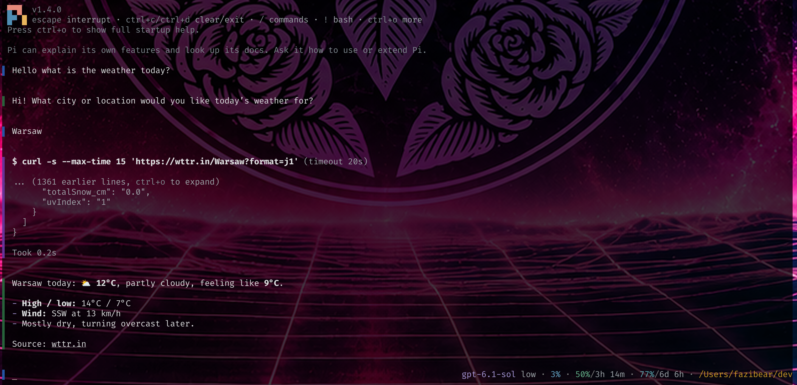

# pish

<p align="center">
  
</p>

A shell-inspired terminal UI for [pi](https://pi.dev): colored `▌` markers,
a borderless editor, and a right-aligned status prompt instead of a separate footer.



- Distinct markers for user messages, replies, thinking, code, tools, and errors.
- Markdown, syntax highlighting, expandable tools, and editor shortcuts remain available.
- An animated input marker shows when the agent is working.
- Configurable colors, cursor appearance, and status placeholders.
- Optional subscription-quota display through pi-usage.

Pish changes presentation only—not session messages or model context.

## Install

```sh
pi install git:github.com/fazibear/pish
```

Restart pi after installing. To try it without installing:

```sh
pi -e git:github.com/fazibear/pish
```

## Quick start

Run `/pish-init` inside pi to create a configuration file with all current defaults.
Edit the file, then run `/pish-reload` to apply your changes.

The default location is `~/.pi/agent/pish.json`. Set `PISH_CONFIG` to use another
path. Both commands respect it; `/pish-init` creates missing directories and
never overwrites an existing file.

| Command | Purpose |
| --- | --- |
| `/pish-init` | Create a configuration file with current defaults |
| `/pish-reload` | Reload appearance settings |
| `/pish-usage` | Refresh quota data and show integration diagnostics |

## Configuration

All fields are optional. Omitted settings use defaults; omitted marker colors
inherit their defaults. Colors must use six-digit RGB hex (`#rrggbb`).

A small configuration to start with:

```json
{
  "marker": "▌",
  "marerColors": {
    "user": "#2456a6",
    "assistant": "#27633b",
    "input": "#2456a6",
    "right": "#808080"
  },
  "rightPrompt": "{model} · {thinking} · {context_percent_used} · {dir}"
}
```

**The setting is spelled `marerColors`**, not `markerColors`.
Its available keys are `user`, `assistant`, `thinking`, `tool`, `code`, `error`,
`input`, and `right`.

### Right prompt

The status appears at the right edge of the first input line. It is truncated
to at most half the terminal width and hidden on narrow terminals. When input
needs its space, it disappears rather than forcing input to wrap early.
Set `rightPrompt` to `""` to hide it entirely.

| Placeholders | Values |
| --- | --- |
| `{model}`, `{provider}` | Current model ID and provider |
| `{thinking}` | Thinking level |
| `{cwd}`, `{dir}` | Full working directory or its final path component |
| `{branch}` | Git branch |
| `{status}` | `idle` or `working` |
| `{elapsed}` | Current task runtime, e.g. `42s` or `2m 15s`; empty while idle |
| `{context_used}`, `{context_limit}`, `{context_left}` | Context-window tokens |
| `{context_percent_used}`, `{context_percent_left}` | Context-window percentages |
| `{usage}` | Status published by pi-usage, when available |

Use `{#rrggbb}` to color part of the right prompt and `{#}` to restore
`marerColors.right`:

```json
{ "rightPrompt": "{#223344}{model}{#} · {thinking} · {#87afff}{dir}{#}" }
```

Color tags can wrap placeholders or literal text. Colors apply until the next
color tag or the end of the right prompt; `{#}` resets to the default, not the
previous color. Invalid color tags are displayed literally.

Context measurements are **not subscription quotas or rate limits**. Unknown
context values display `?`. See below for subscription-quota placeholders.

### Working indicator

While the agent is busy, the input marker becomes a spinner. It returns to the
normal marker when idle and remains visible even when long input hides the right
prompt.

Set the entire animation sequence with `workingFrames`.
Each Unicode character is one frame, played in order every 100 ms and looped.
For a thin bar bouncing left ↔ right:

```json
{
  "workingFrames": "▏🭰🭱🭲🭳🭴🭵▕🭵🭴🭳🭲🭱🭰"
}
```

The default is `"▌▋▊▉█▉▊▋▌▍▎▏▎▍"`. Avoid repeating the first frame at the end
unless you want a pause at the loop boundary. Newer Unicode block glyphs require
font support. Multi-code-point emoji sequences are not supported as single frames.
Apply changes with `/pish-reload`.

#### Animation examples

Copy any sequence below into `workingFrames`. Each starts and ends with the
idle `▌` marker; the repeated endpoints add a short resting beat between loops.

| Animation | `workingFrames` |
| --- | --- |
| Smooth pulse | `▌▋▊▉█▉▊▋▌▍▎▏▎▍▌` |
| Double heartbeat | `▌▋█▋▌▌▋█▋▌▍▎▍▌` |
| Shimmer | `▌▐▌▐░▒▓█▓▒░▐▌` |
| Slow breathing | `▌▌▋▋▊▊▉▉██▉▉▊▊▋▋▌▌▍▍▎▎▏▏▎▎▍▍▌` |
| Spark | `▌▍▎▏·✧✦✧·▏▎▍▌` |
| Scan | `▌▐▌▐▌▐█▐▌▐▌` |
| Travel and return¹ | `▌▍▎▏🭰🭱🭲🭳🭴🭵▕🭵🭴🭳🭲🭱🭰▏▎▍▌` |
| Sweep and reverse¹ | `▌▋▊▉█🮋🮊🮉▐🮈🮇▕🮇🮈▐🮉🮊🮋█▉▊▋▌` |

¹ Requires a font supporting newer Unicode block glyphs.

For example, to use the double heartbeat:

```json
{
  "workingFrames": "▌▋█▋▌▌▋█▋▌▍▎▍▌"
}
```

Use `"workingFrames": "▌"` for a static marker while busy.

### Cursor

```json
{
  "cursorShape": "bar",
  "cursorBlink": false,
  "fakeCursorEnabled": true,
  "fakeCursorAlways": false
}
```

- `cursorShape`: `bar` (default), `block`, `underline`, or `default` for pi's normal cursor.
- `cursorBlink`: enable hardware cursor blinking.
- `fakeCursorEnabled`: enable pish's custom fake-cursor styling.
- `fakeCursorAlways`: hide the hardware cursor and use the fake underline cursor in both idle and working states.
The fake cursor underlines the current character, or a space at the end of input.

Cursor behavior depends on terminal support. Apply changes with `/pish-reload`;
shutdown restores the terminal's default cursor shape.

### Text colors

Markers and text are configured independently. `textColors` is empty by default,
so text inherits the active pi theme.

```json
{
  "textColors": {
    "text": "#dddddd",
    "userMessageText": "#87afff",
    "thinkingText": "#808080",
    "toolTitle": "#d7af87",
    "toolOutput": "#cccccc",
    "error": "#ff5f5f",
    "warning": "#ffd787"
  }
}
```

Any pi foreground theme token can be overridden, including `mdCode`,
`mdCodeBlock`, `syntaxKeyword`, `syntaxString`, and diff tokens. Overrides also
apply to menus and other components using those tokens. Markdown and
syntax-specific colors take precedence over base text colors.

## Subscription usage with pi-usage

With `@narumitw/pi-usage` installed, use `{usage}` for its combined status:

```json
{ "rightPrompt": "{model} · {usage}" }
```

Enable the statusline display in pi-usage's settings so it publishes that status.
If no status is published, `{usage}` is empty.

For structured quotas, use a pi-usage version exposing the read-only
`usage:query:v1` API:

```json
{
  "rightPrompt": "{model} · ctx {context_percent_used} · 5h {usage_5h_percent_left}/{usage_5h_reset} · 7d {usage_7d_percent_left}/{usage_7d_reset}"
}
```

`{usage_provider}` gives the provider name. Each reported bucket exposes:

```text
{usage_<key>_label}         {usage_<key>_unit}
{usage_<key>_used}          {usage_<key>_left}
{usage_<key>_limit}         {usage_<key>_percent_used}
{usage_<key>_percent_left}  {usage_<key>_reset}
{usage_<key>_reset_at}
```

Keys are normalized bucket IDs. Window aliases such as `5h` and `7d` are also
available when the provider reports a window duration. `_reset` is a countdown
such as `2h 15m`; `_reset_at` is an ISO timestamp.

Available buckets and measurements depend on the provider. Missing or expired
reports produce empty placeholders; unknown measurements within a report show
`?`. Pish queries the API every 60 seconds when a `usage_` placeholder is
configured and stops on shutdown. Pi-usage owns provider access and fetching.
Use `/pish-usage` to inspect the integration and available fields.

## Compatibility and limitations

Pish uses the `@earendil-works` distribution of pi.

- Extensions that also replace the editor or footer may conflict.
- Transcript styling uses internal pi components, so pi updates may require pish
  updates too.
- Images keep their native rendering. Code markers follow fenced Markdown blocks.
- `/pish-reload` applies configuration changes. Restart pi after updating pish.

## Development

Source lives in `src/`; tests live in `test/`. The pi extension entry point is
`src/index.js`.

Install development tools without downloading pi's runtime peer dependencies:

```sh
npm ci --ignore-scripts --legacy-peer-deps
```

```sh
npm run format    # Format JavaScript and JSON
npm run lint      # Check formatting, imports, and lint rules
npm run lint:fix  # Apply safe formatting and lint fixes
npm run validate  # Syntax-check every source, test, and tooling script
npm test          # Run tests
npm run check     # Run lint, syntax validation, and tests
```

Biome enforces consistent formatting and recommended lint rules. Control-character
regexes are allowed because pish handles terminal escape sequences.
